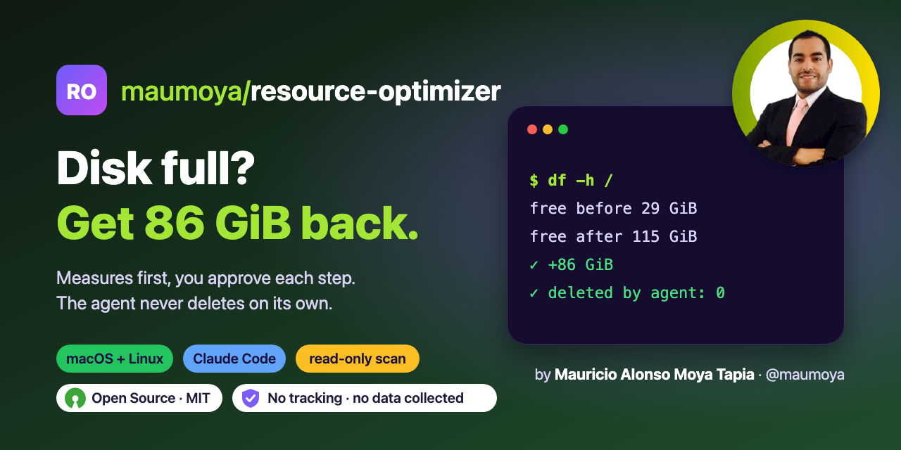

<p align="center">
  
</p>

<p align="center">
  
  <a href="#results-measured-2026-11-03"></a>
  <a href="#results-measured-2026-11-03"></a>
  
  <a href="https://opensource.org/license/mit"></a>
  <a href="PRIVACY.md"></a>
  <a href="https://scorecard.dev/viewer/?uri=github.com/maumoya/resource-optimizer"></a>
  <!-- OpenSSF Best Practices: not registered; run bestpractices.sh maumoya/resource-optimizer -->
</p>

# Resource Optimizer

Frees disk space and eases RAM and CPU load on macOS and Linux: measures read-only, ranks what fills the disk with a plain need-it answer, gives you one command per group to run, proves the result before/after. Never deletes on its own.

<!-- Put a picture or a ≤10 s GIF here: one input → one result. -->

## Install

Claude Code plugin:

```
/plugin marketplace add maumoya/resource-optimizer
/plugin install resource-optimizer@resource-optimizer
```

Any agent that reads skills:

```
npx skills add maumoya/resource-optimizer
```

## Use

Type: `/resource-optimizer` or say "my disk is full".

## Results (measured 2026-11-03)

First real run, a 16 GB Mac mini with a 494 GB disk (2026-11-03). Measured with `scripts/measure.sh` and `df -h /`;
the user ran every command.

| Step | What was cleared | Free space |
|---|---|---|
| Start | (macOS Storage showed 474.82 GB used) | 29 GiB |
| Group A | npm, uv, pip and Homebrew caches; Xcode build output to the Trash | 36 GiB |
| Group B | 4 unused local AI models, iOS simulators, old app leftovers to the Trash | 57 GiB |
| Trash emptied by the user | | 84 GiB |
| Orphan MLX models, an unused node_modules | | 92 GiB |
| Old iOS simulator runtimes (27.0, 27.1; 27.2 kept for builds) | 14.8 GB | 109 GiB |
| 5 unused apps and 2 duplicate apps to the Trash, Trash emptied by the user | | 115 GiB |

**+86 GiB free** (29 → 115 GiB), measured with `df -h /`. The agent deleted 0 files on its own: every permanent step
was the user's command or the user's password in a macOS dialog.

## How it is tested

`evals/` holds one case per promise. Run `claude plugin eval . --allow-tools`.
Every PR runs `scripts/lint_skill.sh` in CI.

## FAQ

### What does it do?

Frees disk space and eases RAM and CPU load on macOS and Linux: measures read-only, ranks what fills the disk with a plain need-it answer, gives you one command per group to run, proves the result before/after. Never deletes on its own.

### Does it send my data anywhere?

No. It is instructions and local scripts only.

<!-- Draft this with skill-forger-e2e's owner_profile.sh, then let the owner edit it. -->
## About the author

Hi, I'm **Mauricio Alonso Moya Tapia** ([@maumoya](https://github.com/maumoya)). I built resource-optimizer because my 16 GB Mac mini ran out of space and every cleaner I tried wanted to delete things on its own.

Say hi or follow my work on [GitHub](https://github.com/maumoya).

## License

MIT © 2026 Mauricio Alonso Moya Tapia
